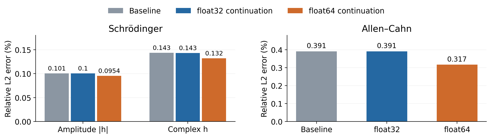

# Continuous- and Discrete-Time PINNs in PyTorch

**Shang Gao · CEE 292 Scientific Machine Learning**

Two examples from [Raissi et al. (2019)](https://doi.org/10.1016/j.jcp.2018.10.045), ported from TensorFlow to PyTorch:

- **Schrodinger:** a continuous-time PINN for the complex solution `h(x, t)`.
- **Allen-Cahn:** a 100-stage IRK model that advances from `t = 0.1` to `t = 0.9`.

The precision experiment continues each baseline in float32 and float64.

## Setup

Use Python 3.11 or 3.12. From this folder:

```bash
python -m venv .venv
source .venv/bin/activate
python -m pip install -e .
python scripts/verify_data.py
python -m unittest discover -s tests -v
```

Data and IRK coefficients are included; see [sources and checksums](data/manifest.json).

## Run

A short CPU run:

```bash
python scripts/train.py --config configs/schrodinger_smoke.json --output results/runs/schrodinger-smoke --device cpu
python scripts/train.py --config configs/allen_cahn_smoke.json --output results/runs/allen-cahn-smoke --device cpu
```

Train the full baselines:

```bash
python scripts/train.py --config configs/schrodinger_paper.json --output results/runs/schrodinger/baseline --device cuda
python scripts/train.py --config configs/allen_cahn_paper.json --output results/runs/allen_cahn/baseline --device cuda
```

Each run saves model weights, predictions, metrics, sampled points, and the loss history. Use a new output folder for each run.

Run the precision comparison from an included baseline:

```bash
python scripts/precision.py --checkpoint results/reference/schrodinger/baseline/model.pt --output results/runs/schrodinger/precision --device cuda
python scripts/precision.py --checkpoint results/reference/allen_cahn/baseline/model.pt --output results/runs/allen_cahn/precision --device cuda
```

The script reads `configs/*_precision_restart.json` and starts both runs from the same weights and training points, with a 5,000-iteration limit. Replace the checkpoint path to use your own baseline. To run one arm directly:

```bash
python scripts/train.py --config configs/allen_cahn_precision_restart.json --dtype float64 --warm-start results/reference/allen_cahn/baseline/model.pt --output results/runs/allen_cahn/float64 --device cuda
```

## Results

Relative L2 errors, in percent:

| Quantity | Paper | PyTorch baseline | float32 continuation | float64 continuation |
|---|---:|---:|---:|---:|
| Schrodinger amplitude | 0.197 | 0.101 | 0.100 | 0.0954 |
| Schrodinger complex field | — | 0.143 | 0.143 | 0.132 |
| Allen-Cahn at t = 0.9 | 0.699 | 0.391 | 0.391 | 0.317 |

The float32 baselines stopped after 8,126 and 14,852 L-BFGS-B iterations on the relative loss-decrease criterion, within a 50,000-iteration budget. Double precision then reduced the errors by 5.0%, 7.8%, and 19.0% relative to float32 continuation. It ran for 5,000 iterations; float32 stopped after 20 and 4.

Logged time per loss-and-gradient evaluation was about 0.26 s for both precisions in Schrodinger, and 0.052 s (float32) versus 0.065 s (float64) in Allen-Cahn. The longer float64 runs mainly reflect their higher evaluation counts.



The six runs are saved in [results/reference](results/reference). Check the weights and redraw the figures:

```bash
python scripts/evaluate.py --reference
python scripts/plot_results.py
```

To evaluate a new run:

```bash
python scripts/evaluate.py results/runs/schrodinger/baseline
```

## Reports and code

- [Project report](reports/CEE292_Report.pdf)
- `src/pinn_main/`: networks, PDE residuals, IRK relations, losses, and optimization.
- `configs/`: baseline, smoke, and precision configurations.
- `tests/`: residual, derivative, optimizer, and sampling checks.
- `reports/`: three-page report and LaTeX source; compile with XeLaTeX or Tectonic.

## Reference

M. Raissi, P. Perdikaris, and G. E. Karniadakis. *Physics-informed neural networks: A deep learning framework for solving forward and inverse problems involving nonlinear partial differential equations*. Journal of Computational Physics, 378:686–707, 2019. [DOI](https://doi.org/10.1016/j.jcp.2018.10.045).

Original code and data: [maziarraissi/PINNs](https://github.com/maziarraissi/PINNs), commit `932f50a2d8ef4e80d1456bbae6887a73ff5166ef`. Upstream files and their license are in `third_party/raissi/`. License: MIT.
